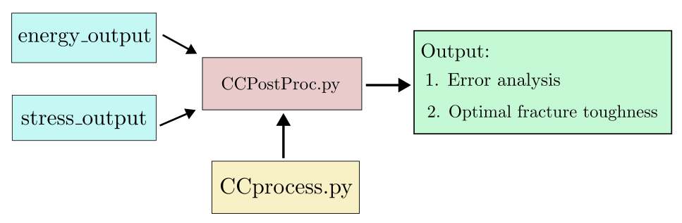

# AbaFracCC: Numerical estimation of the fracture toughness via Coupled Criterion in Abaqus
**Sara Jiménez-Alfaro**$^{1,*}$, **Luis Miguel Ferreira**$^{1,2}$, **Zaarena Gani**$^3$, **Vladislav Mantič**$^1$, and **Luis Távara**$^1$

$^1$ *Departamento de Mecánica de Medios Continuos y Teoría de Estructuras. Escuela Técnica Superior de Ingeniería, Universidad de Sevilla, Camino de los descubrimientos, s/n, 41092, Seville, Spain.*  
$^2$ *Departamento de Mecánica de Medios Continuos y Teoría de Estructuras. Escuela Politécnica Superior, Universidad de Sevilla, Virgen de África, 7, 41011, Seville, Spain.*  
$^3$ *Department of Mechanical Engineering, University College London, Torrington Place, WC1E 7JE, London, United Kingdom*  

$^*$ *Contact:* [sjimenezalfaro@us.es]

The following codes have been used to determine the fracture toughness of extrusion-based additively manufactured 17-4PH stainless steel using Single-Edge Notched Bending (SENB) specimens printed in two different build orientations (flat-lay and upright). The numerical framework and the results can be found in the publication: 

Jiménez-Alfaro, S., Ferreira, L.M., Gani, Z., Távara, L. & Mantic, V. (2026). Fracture toughness evaluation of extrusion-based
additively manufactured 17-4PH stainless steel using U-notched specimens, in press. 

The code is structured into two main sequential modules:

**Finite Element Method Module** 

This module is located in the `FEMProc` folder and generates the Finite Element (FE) solutions for a 3-point bending test on a U-notched specimen in the **D1-F** geometrical configuration. The main script `steel0D1F.py` does not require any additional user input. It automatically iterates along the prescribed crack path by sequentially unbinding (releasing) nodes to calculate the FEM solution across all cracked configurations.

Execute the script using:

```bash
abaqus cae noGUI=steel0D1F.py
```

The abaqus solutions are stored in two different folders. Folder `simulation` stores abaqus processor data, whereas `edition` folder stores the `cae` files. As an example, the first uncracked simulation has been included in the repository. Once the simulation completes, it is necessary to extract: the elastic strain energy for each cracked configuration, and the tensile stress distribution along the expected crack path for the undamaged (uncracked) configuration. This extraction is carried out via `visualizer_energy.py` and `visualizer_stress.py`. Both scripts must be executed inside the simulation directory immediately after running the FEM simulation:

```bash
abaqus python visualizer_energy.py
abaqus python visualizer_stress.py
```

Ambos códigos devuelven dos archivos `.dat` que contienen los inputs necesarios para el Coupled Criterion Post-processing Module. 

**Coupled Criterion Post-processing Module** 

All the codes of the module are contained in the folder `CCPostProc`. The following structure describes the numerical framework:



The main script for this module is `CCPostProc.py`, which must be executed to perform the data post-processing and the Coupled Criterion analysis. It requires two inputs:

* **Elastic strain energy files:** Four `.dat` files located in the `energy_output` directory, containing the evolution of the elastic strain energy along the expected crack path obtained from the previous module for a representative displacement of $U=1$. Each file represents one of the four geometric configurations studied for the $0^\circ$-oriented printed steel.
* **Tensile stress files:** Four `.dat` files located in the `stress_output` directory, containing a two-column matrix. The first column corresponds to the position along the expected crack path where the stress is evaluated, while the second column represents the evolution of the tensile stress along the expected crack path obtained from the previous module for $U=1$. Each file represents one of the four geometric configurations studied for the $0^\circ$-oriented printed steel.

The execution of the Coupled Criterion is carried out in the `CCprocess.py` script. This module outputs two primary matrices: `Ucrit` and `Fcrit`:

* **`Ucrit`:** Contains the critical applied displacements required for crack nucleation across a wide range of fracture properties, namely the tensile strength ($\sigma_c$) and the critical energy release rate ($G_c$). In this matrix, each row corresponds to a specific $\sigma_c$ value, while each column corresponds to a $G_c$ value.
* **`Fcrit`:** Stores the corresponding critical forces, calculated from the critical displacements using the stiffness of the structure.

The analysis of the Coupled Criterion results to determine fracture toughness is carried out via `CCPostProc.py`. Through a minimization process, this script determines the fracture toughness value that minimizes the discrepancy with the critical force obtained from experimental tests. It yields the following outputs:

* **Optimal values of $\sigma_c$, $G_c$, and $K_c$:** Printed directly to the terminal screen alongside the minimum root mean square error (RMSE) achieved.
* **Projection figure (`projection_steel0.svg` in the folder `output`):** Displays the admissible values of $\sigma_{\mathrm{c}}$ and $K_{\mathrm{c}}$ for each specimen in the flat-lay configuration. The yellow region highlights the domain bounded by the four analyzed specimens, whereas the green region indicates an RMS error of less than 5%. The selected optimal point is marked as G.
* **3D evolution of the error figure (`diff_steel0_3D.svg` in the folder `output`):** Displays the evolution of the total error $\sum (\Delta F_{\mathrm{crit}})^2 / F_{\mathrm{exp}}^2$ with respecto to $\sigma_c$ and $K_c$.
* **RMS evolution in a heatmap figure (`rms_steel0_heatmap.svg` in the folder `output`):** Variation of RMS with respect to $\sigma_{\mathrm{c}}$ and $K_{\mathrm{c}}$.
* **Force evolution figure (`surface_steelS1_F.pdf` in the folder `output`):** $F_{\mathrm{crit}}$ as a function of fracture properties for the S1-F configuration. Intersection between numerical and experimental predictions.


 
